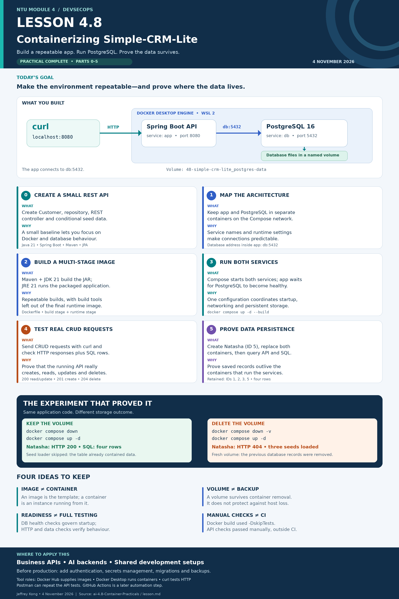

# Lesson 4.8 — Containerizing Simple-CRM-Lite

NTU Module 4 DevSecOps practical completed on 4 November 2026.

A Spring Boot customer REST API and PostgreSQL database running in separate Docker containers, with persistent database storage.

## What I implemented

- Customer entity, JPA repository and REST controller.
- Conditional loading of three sample customers.
- Multi-stage Dockerfile: Maven/JDK 21 builds the application; JRE 21 runs it.
- Docker Compose configuration for the application and PostgreSQL 16.
- Database health check and named volume.
- Manual CRUD and data-persistence verification.

## Run locally

Start Docker Desktop and ensure host ports 8080 and 5432 are available.

From the project root:

```bash
docker compose up -d --build
docker compose logs -f app
```

Wait for `Started SimpleCrmLiteApplication`, then press Ctrl+C to exit the log viewer. The containers continue running.

Test the API:

```bash
curl -i http://localhost:8080/customers
```

## API endpoints

| Method | Endpoint | Purpose |
|---|---|---|
| GET | `/customers` | List customers |
| GET | `/customers/{id}` | Retrieve one customer |
| POST | `/customers` | Create a customer |
| PUT | `/customers/{id}` | Update a customer |
| DELETE | `/customers/{id}` | Delete a customer |

## Verified results

| Check | Observed result |
|---|---|
| CRUD operations | GET 200, POST 201, PUT 200, DELETE 204 |
| Read a deleted customer | HTTP 404 |
| Recreate containers while retaining the volume | Natasha, ID 5, survived; SQL retained four rows |
| Restart with existing data | Sample-data loading was skipped |
| Delete the volume and recreate the stack | Three sample customers loaded again; Natasha's old endpoint returned 404 |

These were manual checks using curl, application logs and PostgreSQL queries. The Docker build uses `-DskipTests`; automated CI testing was outside this practical.

## Storage behaviour

`docker compose down` removes the containers and network while retaining the database volume.

`docker compose down -v` also deletes the database volume and its records. It was used deliberately for the disposable-data reset experiment.

A persistent volume survives container replacement, but it is not a backup.

## Learning infographic



## Learning source

Based on [NTU Lesson 4.8 — Container Practicals](https://github.com/Jefkong77/ai-4.8-Container-Practicals/blob/main/lesson.md).